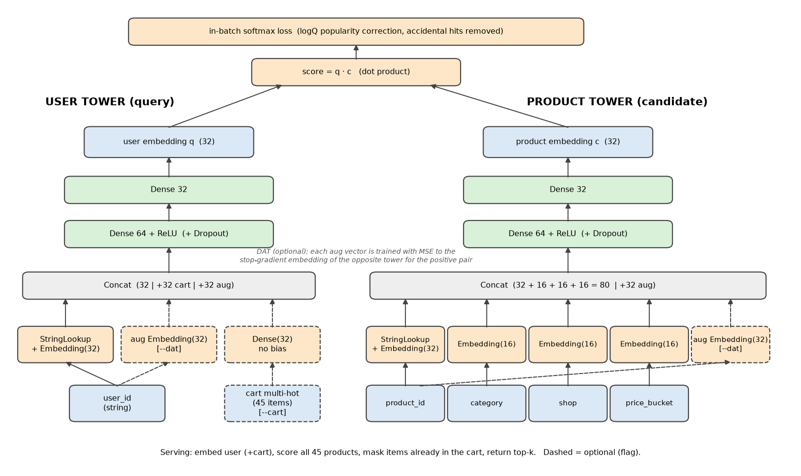
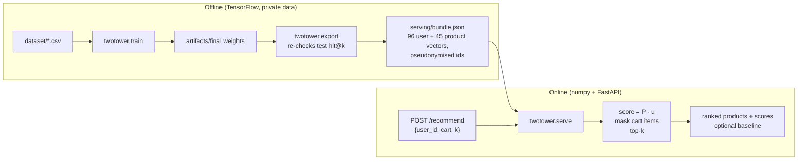
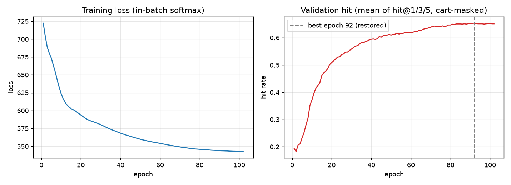

# Two-tower retrieval: Pasar Hasil Bumi

**Live API:** https://pasarhasilbumi-api.vercel.app (interactive docs at [`/docs`](https://pasarhasilbumi-api.vercel.app/docs)).
Portfolio demo spec: [docs/portfolio-demo-brief.md](docs/portfolio-demo-brief.md)

Product retrieval for **Pasar Hasil Bumi**, an agricultural marketplace (vegetables, fruit and spices
from local shops). Given a shopper and the basket they are building, rank the 45 catalogue products by
what they are most likely to add next. This repo is the engineering side of my undergraduate thesis on
Two-Tower recommendation models; the original Colab notebook is kept out of the repo because its
saved outputs contain real database ids.

**What it does today**
- Trains a TensorFlow Recommenders two-tower model (user tower and product tower, dot-product score).
- Evaluates it against random, popularity and personal-frequency baselines with a time-based split.
- Exports the trained model to a 106 KB, TensorFlow-free bundle. When exporting, it checks that the
  saved weights still reproduce the logged test metrics.
- Serves retrieval through a small FastAPI service (numpy only, about 0.25 ms per request) with
  Docker and portfolio integration docs ([docs/integration.md](docs/integration.md)).

## Architecture

Regenerate with `python -m twotower.diagram`. Dashed boxes are optional training flags (`--cart`, `--dat`).

**Key decisions**
- **Precomputed embeddings for serving.** The shipped `final` model has no cart input, so a user's
  vector depends only on their id. Exporting every vector removes TensorFlow (about 1.5 GB) from the
  runtime. A cart-aware model would need the user tower at request time, so `export` refuses those runs.
- **Cart masking.** A basket never repeats a product, so items already in the cart are removed before
  ranking, both in evaluation and in the API.
- **logQ correction.** In-batch softmax over-penalises popular items. The sampling probability
  correction counters this.
- **Honest baselines.** Personal frequency ("what this user usually buys") is the baseline to beat
  on this data (see Results).

## Layout
- `src/twotower/data.py`: loading, 70/10/20 time split, cart features
- `src/twotower/metrics.py`: full-catalogue hit@k and non-learned baselines (no TensorFlow)
- `src/twotower/model.py`: towers and TFRS model. `train.py`: CLI with early stopping on validation hit
- `src/twotower/export.py`: weights to `serving/bundle.json`, with a metric re-check and pseudonymised ids
- `src/twotower/serve.py`: FastAPI retrieval API over the bundle
- `src/twotower/diagram.py`: architecture figure. `reports/`: run log (`runs.csv`), curves, diagram

## Run the API (no private data needed)
`serving/bundle.json` is committed, so anyone can run the demo:

    uv venv .venv-serve --python 3.11
    uv pip install --python .venv-serve/Scripts/python.exe -r requirements-serve.txt
    PYTHONPATH=src .venv-serve/Scripts/python.exe -m uvicorn twotower.serve:app --port 8000
    # open http://localhost:8000/docs for interactive Swagger UI

    docker build -t phb-retrieval . && docker run -p 8000:8000 phb-retrieval

Example request using a held-out test basket from `GET /examples`:

    curl -X POST localhost:8000/recommend -H "content-type: application/json" \
      -d '{"user_id":"u39","cart":["p32","p31","p40"],"k":5,"baseline":"personal_frequency"}'

The basket's hidden item `p17` (Daun Bawang) comes back at rank 1. To deploy, import the repo into
Vercel. The root `app.py` is the entrypoint; see [Deploy on Vercel](docs/integration.md#deploy-on-vercel). The full contract, error codes,
env vars, CORS and hosting notes are in [docs/integration.md](docs/integration.md).

## Train, evaluate, export (needs the private dataset)
    uv venv .venv --python 3.11          # TF 2.15 needs Python <= 3.11
    uv pip install --python .venv/Scripts/python.exe -e ".[train,dev]"   # base deps are API-only
    .venv/Scripts/python.exe -m pytest
    .venv/Scripts/python.exe -m twotower.train --tag mine [--cart --drop 0.2 --dim 64 --dat --save ...]
    .venv/Scripts/python.exe -m twotower.export --tag final   # needs artifacts/final (from --save)

Data goes in `dataset/`, which is not in the repo because it holds production exports:
`prod.users.csv`, `prod.products.csv` and `transactions.csv`. Each training run prints a table, appends
to `reports/runs.csv` and writes `reports/<tag>.json`. `--save` stores weights in `artifacts/<tag>`.
The `final` row used the default flags with `--tag final --save`. A retrain was not re-run while
preparing this README, and TensorFlow on CPU is not bit-deterministic, so expect small differences.

## Evaluation protocol
- Transactions are split by timestamp: 70% train, 10% validation, 20% test (4236 / 605 / 1210 rows).
  Rows of one basket share a timestamp, so no basket is split across sets.
- Each test row is (user, basket minus one item). The model ranks the held-out item against **all 45
  products**, with the rest of the basket masked. Ties count as misses.
- Early stopping uses the validation mean of hit@1/3/5. Test numbers come from the restored best epoch.

## Results (test, cart-masked hit@k)

| | @1 | @3 | @5 | @10 |
|---|---|---|---|---|
| random | 0.017 | 0.076 | 0.120 | 0.233 |
| popularity | 0.098 | 0.236 | 0.358 | 0.584 |
| personal frequency | 0.381 | 0.769 | 0.860 | 0.912 |
| two-tower (`final`, served) | 0.387 | 0.755 | 0.841 | 0.892 |

These numbers come from `reports/runs.csv`. `twotower.export` re-derives the two-tower row from the
saved weights and from the exported vectors, and stops if either differs from the log. `GET /model`
serves the same table.

DAT (`--dat`, mean of 3 seeds) scores 0.382 / 0.755 / 0.850 / 0.903, against 0.380 / 0.740 / 0.838 / 0.903
for the plain model. The gain at @3/@5 is small but consistent. Seed std is about 0.01, so treat it as
suggestive. DAT is still below personal frequency.

## Limitations
- **The transactions are synthetic.** 80% of picks are drawn from 3-6 per-user favourites. A user-id
  two-tower can at best learn "personal frequency", and it roughly matches it here. Validate on real
  orders before claiming more.
- **No cold start.** Unknown users get a 404. The model has no features beyond the user id.
- **The served model ignores cart contents.** The cart only masks items. The `--cart` variant
  overfits on this data, and serving it would need TensorFlow at request time.
- **The catalogue is tiny** (45 items), so this is brute-force scoring, not ANN retrieval.

**Future work:** evaluate on real orders; add user features for cold start; use a cart-aware tower
exported via TF SavedModel or ONNX; use an ANN index (e.g. ScaNN) if the catalogue grows.
